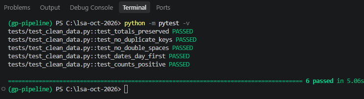

# GP Appointments Data Pipeline

An end-to-end data pipeline for NHS England **"Appointments in General Practice"** data.

**Extract -> Transform -> Load -> Showcase**

| Week | Stage | Status |
|---|---|---|
| 1 | Extract: copy raw files, convert Excel, write manifest, profile the data | ✅ Done |
| 2 | Transform: clean with PySpark, write Parquet, test with pytest | ✅ Done |
| 3 | Load: build the warehouse in DuckDB | To do |
| 4 | Showcase: dashboard in Streamlit + Plotly | To do |

## Tech stack
- **Python 3.12**: in a virtual environment
- **PySpark 4.2.0**: cleaning and transforming (needs Java)
- **pandas, openpyxl, pyarrow**: Excel conversion, profiling, reading Parquet in tests
- **pytest**: data tests
- **DuckDB**, **Streamlit + Plotly** 

## The data
| Dataset | One row is… | Raw rows | Clean rows | Total appointments | Period |
|---|---|---|---|---|---|
| `appointments_regional` | ICB x month x status x HCP type x mode x booking x wait | 596,821 | 295,692 | 742,804,525 | Jan 2020 – Jun 2022 |
| `national_categories` | sub-ICB x day x service setting x context type x national category | 817,394 | 817,394 | 296,046,770 | (from data_profile.md) |
| `actual_duration` | sub-ICB x day x duration band | 137,793 | 137,793 | 167,980,692 | Dec 2021 – Jun 2022 |

Full profile: [docs/data_profile.md](docs/data_profile.md)

## Folder layout
```
lsa-oct-2026/
├── src/
│   ├── extract.py        # copy raw files, Excel → CSV, write manifest
│   ├── profile_data.py   # profile the 3 raw files
│   ├── transform.py      # clean with PySpark → Parquet
│   └── load.py           # Week 3
├── tests/
│   └── test_clean_data.py
├── docs/
│   ├── data_profile.md   # what the raw data looks like
│   ├── decision_log.md   # why each cleaning choice was made
│   └── manifest.json     # file sizes, SHA-256 checksums, row counts
├── app/                  # Week 4 dashboard
├── data/raw/             # not on GitHub, rebuilt by extract.py
├── data/clean/           # not on GitHub, rebuilt by transform.py
└── requirements.txt
```

## Setup (Windows)
1. Already Installed **Python 3.12** and **Java 25** (Spark runs on Java).
2. Create the environment and install the packages, from the project folder:
```
   python -m venv .venv
   .venv\Scripts\activate
   pip install -r requirements.txt
```
3. **Windows only:** Spark needs two Hadoop helper files to write files on Windows. Download `winutils.exe` and `hadoop.dll` from [cdarlint/winutils](https://github.com/cdarlint/winutils) (`hadoop-3.3.6/bin`) into `C:\hadoop\bin`. `transform.py` sets `HADOOP_HOME` and `PATH` itself.
4. Put the source files in a folder and set `SOURCE` at the top of `src/extract.py`.

## How to run
From the project folder, with the environment active:
```
python src/extract.py
python src/transform.py
python -m pytest -v
```

## What Transform does
- Reads every file with an **explicit schema** and `FAILFAST`, so a bad value stops the run instead of slipping through.
- Collapses **repeated spaces** in label columns and fixes `Other Practice staff` → `Other Practice Staff`.
- **Regional:** sums look-alike rows instead of dropping them: 596,821 → 295,692 rows, total unchanged.
- **Categories:** removes the hidden byte-order mark in the header, parses **day-first dates** (`dd/MM/yyyy`), and extracts the sub-ICB code from the name.
- **Duration:** parses dates and adds `appointment_month`.
- Writes **Parquet**, partitioned by `appointment_month`, one file per month. Regional shrinks from 38.7 MB as CSV to about 2.0 MB.

Every choice is explained in [docs/decision_log.md](docs/decision_log.md).

## Tests
6 tests in `tests/test_clean_data.py`: row counts, totals preserved, no duplicate keys, no double spaces, dates parsed day-first, counts positive. Each one was broken on purpose once to prove it fails.

Result on 18 Oct 2026:




